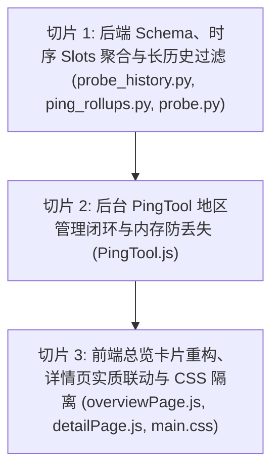

# 资产总览卡片与地区 PING 架构修正实施合同（IMPLEMENTATION_CONTRACT.md）

> 适用基线：`clean c36a2b9`\
> 适用目标：作为无需二次推断的唯一规范直接交付 Codex 执行\
> 架构红线：无新告警阈值、无新外部依赖、无新数据库表、无新独立后台服务；不改写原 `openPremiumCalculator` 现有逻辑；不破坏现有 505 个单元测试；严禁在合同中留下“例如/可选择/多数”等模棱两可的字眼。

---

## 1. 架构决策裁定（D1 ~ D7 严格裁定）

### D1【字面接口与真实数据边界】
1. **已有与新增辅助函数边界**：
   - **已有函数严格复用**：`overviewPage.js` 现存的 `maskIpForOverview(ip)`、`daysUntilExpiry(expiry)`、`fmtResourceGb(bytes)`、`toDisplay(val)`、`calcResidualValue(server)`、`getMonthlyPrice(server)` 为唯一合法旧入口。
   - **新增辅助函数唯一命名（必须标 `[NEW]`）**：
     - `[NEW] formatExpiryDays(expiry)`：内部调用 `daysUntilExpiry(expiry)`，输入 ISO 字符串，返回值严格为字符串：大于 0 返回 `"余期${days}天"`，小于等于 0 返回 `"已过期"`，无有效值返回 `"—"`。
     - `[NEW] formatUptimeDuration(seconds)`：将整数秒格式化为连续非空中文单位，规则固定为：天数大于 0 输出 `"${d}天${h}小时${m}分"`；天数等于 0 且小时大于 0 输出 `"${h}小时${m}分"`；小于 1 小时输出 `"${m}分"`；秒数无效输出 `"刚刚在线"`。
     - 货币与资费：走既有货币格式化器（跟随节点所属货币符号），**严禁代码内硬编码 `¥` 符号**。
     - 计算器调用：**`openPremiumCalculator` 原函数体保持原字节不变**，卡片显式计算器按钮 `.public-money-btn` 与余值点击直接触发该函数。
2. **硬件规格真实性与缺项隔离（Raw-Present 标志）**：
   - 严禁扩充公开 `agent_config`。
   - 在前端 `normalizeServer` 映射层中，增加 4 个明确的布尔属性：
     - `has_real_cpu: Boolean(raw.cpu_cores != null || raw.cpu != null)`
     - `has_real_ram: Boolean(raw.ram_gb != null || raw.ram != null)`
     - `has_real_disk: Boolean(raw.disk_gb != null || raw.disk != null)`
     - `has_real_hostname: Boolean(raw.hostname && String(raw.hostname).trim() !== '' && String(raw.hostname).trim() !== String(raw.name).trim())`
   - **渲染显示断言**：
     - CPU 负载位：因公开 DTO 无系统 load 指标，该位置**固定显示占位符 `—`**，副文本为 `— / ${s.cpu}核`（若 `has_real_cpu` 为 false 则显示 `—`），严禁捏造或计算虚假负载。
     - 内存规格：若 `has_real_ram` 为 false，规格文本显示 `—`，仅渲染已用百分比进度条。
     - 硬盘规格：若 `has_real_disk` 为 false，规格文本显示 `—`。
     - 主机名行：若 `has_real_hostname` 为 false，隐藏主机名段落，仅显示脱敏 IP。

### D2【Region 一致兼容与存储语义】
1. **统一表示与三种层级语义**：
   - **持久化层（Backend `agent_config.ping_targets`）**：
     - 字段类型为字符串，必须执行 `strip()`。
     - 合法有效值：长度为 1~32 个字符的非空字符串。
     - 若为空字符串、全部空白字符或未配置，**序列化时直接从目标字典中移除 `region` 键**，绝不在数据库中写入 `"default"` 字符串，保持 JSON 存储最小化。
     - 校验拒绝语义：若用户提交的 `region` 长度超过 32 字符或包含换行符（`\r`, `\n`），接口返回 `400 Bad Request`，事务完整回滚，严禁静默截断写入。
   - **公开读取层（`probe.py` DTO）**：
     - 若配置中存在有效 `region`，原样输出该字符串；若无，输出 `region: ""`（严格空字符串，非 null，非 "default"）。
   - **前端展示层（UI Sentinel）**：
     - 统一定义内部常量 `REGION_UNGROUPED = "__ungrouped__"`。
     - 当 target 的 `region` 为空字符串时，归入 `__ungrouped__` 分组，下拉框选项文本固定显示为 `"未分组"`。
     - 真实地区名完全允许叫 `"default"`（此时它是真实地区而不是未分组）；未分组在 UI 上的显示文本严格由 `__ungrouped__` 映射为 `"未分组"`。
     - 严禁对 undefined/null 执行盲目字符串化，杜绝页面出现 `"undefined"` 或 `"[object Object]"`。

### D3【Slots 严格统计与互斥判定口径】
1. **最小兼容 SQL 聚合扩展**：
   - 修改 `services/probe_history.py::_fetch_ping_target_history`，保留原 `points` 返回结构供图表向下兼容，新增聚合查询计算真实采样指标，在同次调用中输出带状态时序的 `slots` 数组。
   - SQL 聚合字段必须包含：
     - `COUNT(id) AS sample_count`（真实上报探测批次数，非 ICMP 包数）
     - `SUM(CASE WHEN success = 1 THEN 1 ELSE 0 END) AS success_count`
     - `SUM(CASE WHEN success = 0 THEN 1 ELSE 0 END) AS fail_count`
     - `MIN(created_at) AS first_seen`
     - `MAX(created_at) AS last_seen`
     - `AVG(latency_ms) AS avg_latency`
     - `AVG(loss_pct) AS reported_loss_pct`
2. **固定分桶配置与时间锚点**：
   - 时间窗口固定为 3 档，杜绝动态任意时长：
     - `1h`（hours=1）：桶宽 300 秒（5 分钟），固定槽数 **12 槽**。
     - `6h`（hours=6）：桶宽 900 秒（15 分钟），固定槽数 **24 槽**。
     - `24h`（hours=24）：桶宽 3600 秒（60 分钟），固定槽数 **24 槽**。
   - 时间轴锚点：以请求时间（UTC）向下对齐桶宽整数倍作为最后一个槽的终点，依次向前推导生成严格固定长度的连续时间槽数组。
   - 缺样本窗：若该时间段内无任何记录（`sample_count == 0`），该槽位保留为空白缺失槽，**严禁使用前一个槽位的值或最后已知值填充充槽**。
3. **单向互斥状态判定流程（必须按此严格顺序求值）**：
   对每个槽位，依序执行以下判定，首个匹配即确定状态：
   - 步骤 1：若 `sample_count == 0`，判定为 **`"missing"`**。
   - 步骤 2：若 `success_count == 0`，判定为 **`"fail"`**。
   - 步骤 3：若 `fail_count > 0` 或 `(reported_loss_pct != null 且 reported_loss_pct > 0.0)`，判定为 **`"loss"`**。
   - 步骤 4：判定为 **`"ok"`**。
4. **指标口径字段定义**：
   - `latency_ms`：当且仅当 `success_count > 0` 时输出 `avg_latency`（四舍五入保留 1 位小数）；若为 `"missing"` 或 `"fail"`，固定输出 `null`。
   - `loss_pct`：当 `sample_count == 0` 时固定输出 `null`；当 `sample_count > 0` 时，丢包率严格取值：若存在上报 `reported_loss_pct` 则采用之，否则通过 `(fail_count / sample_count) * 100.0` 计算，范围严格限制在 `[0.0, 100.0]`。不猜测底层单次 ping 发包数量。

### D4【API 契约、长历史 (30/90d) 与别名归并】
1. **只读 API 契约**：
   - `[EXISTING]` 元数据：`GET /api/ping-targets/{server_id}`，返回配置的目标列表，每项目标透传 `region: String`。
   - `[PROPOSED]` slots 历史聚合：`GET /api/ping-targets/{server_id}/history`
     - 参数：
       - `hours`: 整数枚举 `1 | 6 | 24`（缺省 1）。
       - `region`: 字符串（可选）。若传入有效地区名，仅返回该地区目标；若传入 `__ungrouped__`，仅返回未配置地区的目标；若不传，返回全量目标。
     - 响应体格式：
       ```json
       {
         "server_id": 101,
         "window_hours": 1,
         "bucket_seconds": 300,
         "targets": [
           {
             "key": "hk-cmi",
             "label": "香港CMI",
             "region": "香港",
             "protocol": "tcp",
             "summary": { "latency_ms": 167.0, "loss_pct": 0.0 },
             "slots": [
               {
                 "start": "2026-11-07T02:00:00Z",
                 "end": "2026-11-07T02:05:00Z",
                 "status": "ok",
                 "latency_ms": 167.2,
                 "loss_pct": 0.0,
                 "sample_count": 5,
                 "fail_count": 0
               }
             ],
             "points": [ ... ]
           }
         ]
       }
       ```
   - 现有 snapshot 无 slots，总览页**严禁**假定首屏时序已在 snapshot 中。
2. **并发控制与按需拉取**：
   - 前端维护调度队列，全局最大并发请求数严格限制为 **4**（`MAX_PING_CONCURRENT = 4`）。
   - 总览页结合 `IntersectionObserver`，仅对视口内可见卡片拉取 `history`；滚出视口卡片取消其排队请求；刷新周期固定为 **30 秒**，与 servers 10s 轮询完全解耦。
3. **长历史（30d / 90d）与 Peer 隔离**：
   - 修改 `services/ping_rollups.py::query_ping_rollups`，接收可选 `target_keys` 参数。
   - 详情页 30d/90d 视图切换地区时，必须提取该节点在当前选中地区下的配置目标 key 列表传入，后端使用 SQL `WHERE target_key IN (...)` 过滤。杜绝混入 VPS Peer 探针，杜绝长历史地区筛选失效。
4. **历史别名（Alias）确定性折叠**：
   - 节点当前合法目标清单以 `agent_config.ping_targets` 中的条目为权威源。
   - 映射规则：当且仅当一个历史 `target_key`（如记录的是旧 host 或 label）在当前配置中通过 `host` 或 `label` 能**唯一反查到单个目标且协议相同**时，判定为有效别名并归入该目标的 key。
   - 歧义规则：若存在同一 host 但端口/协议不同的多条目标，或反查匹配到多条目标，**判定为歧义**；歧义记录严格保留其原始 key，独立分行，绝不合并，防止协议/端口指标污染。

### D5【后台按地区选择与编辑保全 (PingTool.js)】
1. **全量数据内存保全（解决静默丢失）**：
   - `PingTool` 实例维护全量目标数组 `this._allTargets`，UI 增加地区筛选下拉框（包含“全部”、已有去重地区、以及“未分组”）。
   - 切换地区筛选仅影响表格当前可见子集的渲染。
   - 用户的增、删、改操作直接同步写入 `this._allTargets`。
   - 保存操作触发时，直接取 `this._allTargets` 全量进行合法性清洗和提交，**绝对禁止通过遍历 DOM 行来收集保存数据**，确保被隐藏地区的行数据完整不丢失。
2. **单节点持久化与清空边界**：
   - 保存时调用既有 `updateAgentConfig(server.id, { ping_targets: cleanedTargets })`。
   - 清空保存时写入明确的 `ping_targets: []`，后端持久化空列表，公开接口返回 `not_configured: true`，严禁触发默认预设恢复。
   - 不创建任何全局表、全局字段或预设自动启用机制。

### D6【详情页实质功能与状态控制】
1. **控件落点与状态管理**：
   - 在 [`detailPage.js`](file:///root/.hermes/plans/vps-assets-regional-ping-20261107/worktree/frontend-vite/src/pages/detailPage.js) 的 External PING 区域头部，增加地区选择下拉控件 `<select class="ping-region-select">`。
   - 状态挂载于详情页局部闭包：`detailPingState = { region: 'all', timeRange: 1, reqSeq: 0 }`。
   - 选项由当前节点的 `agent_config.ping_targets` 动态提取，去重后构建。
2. **图表更新与竞态阻断**：
   - 地区或时间范围切换时，调用 `detailCharts.js` 原生 API 原地更新数据集并触发 `chart.update()`，禁止销毁并重建 Canvas 节点。
   - 异步竞态：发起请求时 `detailPingState.reqSeq++`，并在本地闭包捕获该序列号；响应到达时必须断言 `reqSeq === detailPingState.reqSeq`，否则直接丢弃。
   - 10s 刷新或 locale 改变时，从 `detailPingState` 恢复选中值，确保用户选择态不被重置。
   - 既有 0/1/4/7/30/90 天选择器、1h CPU/RAM 图表、Peer 探针表格原 DOM 与数据通道保持 100% 隔离不变。

### D7【CSS 级联隔离与生命周期管理】
1. **!important 冲突精确解耦方案**：
   - 根因定位：
     - `starfleet-theme.css` 中 `.public-overview-card` 带有 `padding-left: 28px !important;`。
     - `main.css` 中 `.public-overview-card.is-dense .public-overview-grid` 声明了 4 列 `repeat(4, minmax(0, 1fr)) !important;`。
   - 实施方案：
     - 新卡移除 `.is-dense` 类名，新增独立复合类 `.is-v2-card`。
     - 在 `starfleet-theme.css` 将旧内边距限定为 `.public-overview-card:not(.is-v2-card)`，彻底解除对新卡的污染，避免滥用 `!important` 覆盖。
     - 在 `main.css` 结尾处新增布局定义：
       ```css
       .public-overview-card.is-v2-card {
         min-width: 320px;
         padding-left: 14px;
       }
       .public-overview-card.is-v2-card .overview-resource-2x2 {
         display: grid;
         grid-template-columns: repeat(2, minmax(0, 1fr));
         gap: 8px;
       }
       .public-overview-card.is-v2-card .overview-stats-3col {
         display: grid;
         grid-template-columns: repeat(3, minmax(0, 1fr));
         gap: 6px;
       }
       ```
2. **生命周期与状态保全**：
   - 维持模块级字典 `overviewCardStates = new Map()`，以 `server.id` 为键，保存 `{ selectedRegion, activeWindow, reqSeq }`。
   - 10s `renderOverviewNodeCard` 重新生成 DOM 时，读取当前已有状态并设置对应选中项；若被选中的地区已被删除，自动安全回退至 `"all"` 或 `REGION_UNGROUPED`。
   - 观察者生命周期：每个卡片仅在首次进入视口时注册单例调度任务，不得在 10s 重建时反复创建重复的 `IntersectionObserver` 实例。
3. **事件隔离（阻止卡片整体导航误触）**：
   - 计算器按钮（`.public-money-btn`）、地区下拉框（`select`）、时间切换按钮（`button`）、时序格子（`.ping-slot`）及其容器的 `click`、`pointerdown` 以及键盘 `keydown`（Enter / Space）事件处理首行，必须显式调用：
     `event.stopPropagation();`
   - 确保卡片根节点的详情页跳转事件不会被任何内部组件的交互触发。

---

## 2. 纵向实现切片规划



- **切片 1（后端聚合与过滤）**：
  - `services/probe_history.py`：扩展聚合查询，输出 `sample_count`、`success_count`、`fail_count`，组装 `slots` 数组并实现互斥状态判定。
  - `services/ping_rollups.py`：扩展 `query_ping_rollups`，支持 `target_keys` 列表过滤。
  - `api/probe.py`：透传 `region` 字段，支持 `hours` 与 `region` 参数。
- **切片 2（后台配置与持久化）**：
  - `frontend-vite/src/components/admin/PingTool.js`：实现地区筛选、`this._allTargets` 内存隔离、全量安全保存与空配置清空。
- **切片 3（前端布局与交互）**：
  - `frontend-vite/src/styles/main.css` & `starfleet-theme.css`：解绑旧 4 列与 padding，建立 2×2 与 3 列网格。
  - `frontend-vite/src/pages/overviewPage.js`：实施 2×2 资源网格、3 列即时统计、计算器唤起、4 并发视口拉取、防冒泡及 10s 状态恢复。
  - `frontend-vite/src/pages/detailPage.js`：实现地区下拉控件、30d/90d 目标过滤与 Chart 原地更新。

---

## 3. 命名验收断言清单（捕获不良实现）

| 断言标识 | 验证要求 | 捕获并消除的不良实现模式 |
| :--- | :--- | :--- |
| **`test_slots_status_mutual_exclusion`** | 断言 4 种状态的互斥流，在 `sample_count == 0` 时必须为 `"missing"` 且 latency 为 null；全失败必须为 `"fail"`；部分失败必须为 `"loss"`。 | 捕获将无样本填充为 0ms/0% 捏造虚假健康度、或 `"ok"` 与 `"loss"` 判定重叠的坏实现。 |
| **`test_slots_no_value_replication_on_gap`** | 断言当探测器在某时间段中断时，该槽位严格为 `"missing"`，断言其未复制上一槽位的延迟数据。 | 捕获利用最新值或上一个值盲目填充空白槽位的坏实现。 |
| **`test_pingtool_hidden_targets_preserved_on_save`** | 在 PingTool 筛选出“广东”并编辑其中一行后点击保存，断言读回数据仍完整包含属于“香港”的目标。 | 捕获直接从当前 DOM 提取行导致未显示的其它地区目标被静默删除的坏实现。 |
| **`test_pingtool_clear_persists_empty_array`** | 点击清空并保存后，断言数据库记录为 `[]`，公开接口返回 `not_configured: true`。 | 捕获清空保存被错误降级为回退恢复默认 4 目标预设的坏实现。 |
| **`test_detail_30d_rollups_strictly_filtered_by_region`** | 在详情页切换至 30 天视图并选择特定地区，断言向后端请求的 key 列表只包含该地区 targets，且不含 peer。 | 捕获 30d/90d 视图地区筛选失效、或混入 VPS Peer 探针数据的坏实现。 |
| **`test_alias_unambiguous_resolution`** | 仅当 host/label 能唯一映射到单个配置目标时合并；当同一 host 配置了不同端口时，断言两项独立分行。 | 捕获根据 host 粗暴聚合导致不同协议/端口混成单条线路的坏实现。 |
| **`test_overview_card_event_bubbling_isolated`** | 在总览卡片的原生 DOM 上触发地区下拉选择、时间按钮点击、时序格子 hover、以及在计算器按钮上按 Enter，断言卡片根节点的详情跳转未被触发。 | 捕获事件冒泡未拦截导致内部任何点击都误跳转详情页的坏实现。 |
| **`test_overview_card_state_persists_across_poll`** | 用户将卡片 A 切换为“香港”并选“6h”，等待 10s 触发 servers 轮询重建 DOM，断言卡片 A 依旧显示“香港”和“6h”。 | 捕获定时重绘卡片把用户交互强行刷回默认状态的坏实现。 |
| **`test_concurrent_probe_request_pool_cap_4`** | 同时将 20 张卡片置入视口，断言排队网络请求池在任意时刻的活跃并发数严格小于等于 4。 | 捕获瞬间发起大量 HTTP 请求打爆后端的坏实现。 |
| **`test_raw_present_fallback_integrity`** | 当后端 DTO 的 hardware 字段为空时，断言卡片不展示 1核/1G/20G，而展示 `—`；主机名为空时断言不重复展示节点名。 | 捕获把前端 fallback 默认兜底值当成真实规格展示的坏实现。 |
| **`test_premium_calculator_bidirectional_and_byte_identity`** | 断言 `openPremiumCalculator` 源码字节未被篡改，且在弹窗内输入比例同步更新金额、输入金额反向推导比例。 | 捕获改动或破坏现有溢价计算器双向数据绑定的坏实现。 |