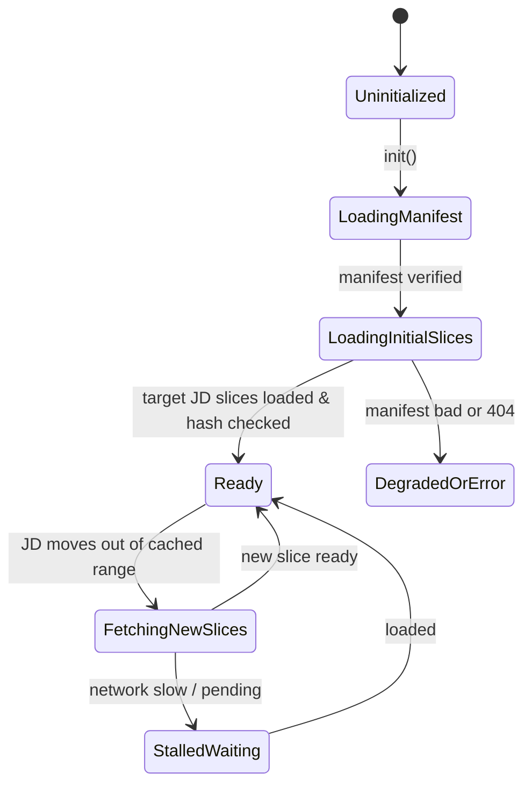

# Solar realtime position / revolution slice

Claude architecture and final review: **WAIVED**, scoped to this slice by the user. This is not APPROVED or an endorsement. agy/TDD and independent parent acceptance remain required.

## Implemented binding

- New pages and reloads create a wall-clock-driven 1x clock. URL and storage do not restore time or acceleration. Render delta only drives existing illustrative spin/camera/belt visuals, never the scientific epoch. Drag, background, render pause and Cesium round trips do not freeze reality time.
- Manual native buttons select exactly 1/60/3600/86400; non-1x switches reanchor the current epoch with monotonic elapsed time. 1x and Now explicitly return to current UTC. No date editor or new picking surface.
- UTC conversion uses naif0012.tls constants and leap table. Before 1972 the LSK conversion extrapolates ΔAT=9s (not a claim of historical UTC fidelity); after 2017 it assumes the last known ΔAT=37s, not future leap-second prediction. System UTC correctness is assumed; there is no frame-integration drift guarantee beyond host wall-clock accuracy/scheduling.
- Precision providers publicly return already-converted ECLIPJ2000 AU: planets/Halley heliocentric, Moon geocentric 301/399. Sun stays at the display origin. Mars–Neptune are system barycentres 4–8/10, not body-centre 499–899. No Pluto/PCK/rotation model additions. Existing spin is illustrative and unvalidated by this slice.
- All cold-start targets stay hidden before verified slices. Loading holds the last applied transforms with explicitly non-ready status and lastApplied epoch; only a current render sample applies transforms. Monotonic request IDs reject stale completion state changes. No old P1/two-body/wrapped production fallback. The old runtime subtraction remains only for explicitly non-geocentric legacy unit providers.
- Ordinary HTTP computes real SHA-256 using exact @noble/hashes@1.4.0. Secure WebCrypto is optional. Payload length and hash precede decode/cache; files are limited to 128 KiB, four active fetches, 2 MiB LRU. SW scientific precaching is excluded by existing glob patterns and checked in the built output.
- Dust changes are limited to covered-range/release-history availability, loading readiness and epoch discontinuity. Worker integration, particle geometry, materials, brightness, BETAS/STEP/RELEASE constants are unchanged.

## Scientific contract and current verification scope

New reference fixture is generated from original BSP and LSK via CSPICE, and original archived Horizons text, never from the new JS solver. 739 UTC cases include 731 daily samples, leap edges and a freshly read generation wall clock; 180 DE440 vector comparisons include true lunar perigee. Limits remain 1e-9 day and 1e-10 AU numerical consistency, not observational accuracy.

The original 1e-10 AU native DE440 arithmetic budget must not be applied to the separate compact Halley fit. The highest-priority agy correction keeps DE440 at 1e-10 AU and UTC/TDB at 1e-9 day, and binds Halley representation-vs-Horizons residuals to the independently declared 10 km / 0.001 km/s budgets. These are not observational-accuracy claims. The five immutable original gzip archives are checked by SHA and parsed into a complete 73051-day grid; all 36525 untrained odd days are evaluated. All four original overlap conflicts are retained, with the later original row used at shared epochs and no averaging, source edits or refitting.

The current scoped user override assigns verification-script/test correction to Hermes, retains the existing product source and scientific assets unchanged, and assigns visual acceptance to the user on a reversible 192 frontend preview. No Codex dispatch, image publication, GitHub delivery or unrelated backend/data/secret change is part of this verification correction. Technical gates and user visual approval are distinct.

## Reproduction

- Run the focused solarRealtime/solarClock/solarPrecision/solarIntegrity unit tests and the full existing quality/build gates. The corrected science verifier rejects empty/short evidence, training contamination, source changes and excessive position/velocity residuals; green evidence must come from the actual runner.
- Run node scripts/verify-precision-manifest.mjs --root public and --root ../frontend-dist.
- Run node scripts/solar-realtime-check.mjs --public-root public --output <RUN>/science-results.json.
- Regenerate the fixture with scripts/solar-realtime-science.py using the designated science venv, original BSP, LSK and archived Halley source directory (required flags shown by --help).
- scripts/solar-realtime-browser.py --dist ../frontend-dist --output <RUN>/browser --negative-controls runs the actual full-page widget on ordinary non-localhost HTTP with installed Playwright, Chromium and an owned Xvfb display. It observes the real production advance method without replacing it, binds its entry wall clock/timeSample/applied epoch/ten target transforms to the same call, and waits for the actual renderer frame to advance. Local business API data is explicitly synthetic; scientific inputs are the real verified assets. Hidden-tab, drag/resume, native rates/Now, Earth–Cesium–Esc, Moon/Sun navigation and finite HTTP payload corruption are separate technical cases. Fixed-clock and unsolicited-acceleration controls run only in disposable local dist copies. --url requires --allow-live-preview and uses actual public API responses; negative controls are forbidden on a live target. A technical PASS is not visual approval; the user owns that gate.

## Bound agy design (verbatim)

# 实时高精度星历系统设计合同（返修修订版）

## 1. 相对上一版裁定与设计差异

| 模块 / 决策点 | 上一版保留项 | 本版废除 / 修正项 |
| :--- | :--- | :--- |
| **时钟基准** | `Date.now()` UTC 转 NAIF LSK TDB；非 1x 锚点推进；刷新强置 1x 现实。 | 废除“墙钟绝对零漂移”宣称；**拖拽不冻结科学时钟**，首有效帧直接取最新墙钟；明确闰秒假设。 |
| **倍率切换** | 支持 1x（现实）、60x、3600x、86400x 及“回到现实”功能。 | 消除“无跳跃”与“实时”矛盾：**非 1x 互切连续平滑重锚定**；**切至 1x 或点击“回到现实”定义为显式跳回当前 UTC 墙钟**。 |
| **冷启动与加载态** | 865 个 DE440/Halley 切片按需加载与 2MiB LRU 缓存。 | **禁止冷启动回退显示无星历的旧二体默认位置冒充当前**；未就绪明确标注加载中，旧请求晚到严禁倒灌。 |
| **坐标与精度** | DE440 太阳系天体与独立 Halley/Horizons 多项式解算。 | 废除“物理精度 <1m/<10m”无依据宣称；**区分数值一致性容差（1e-10 AU）与观测模型**；月球改为严格地心相对向量。 |
| **地月距离边界** | 检查月球位置有效性。 | **废除 0.0024 AU 硬下界**（真实近地点会达 0.002384 AU），改为 CSPICE 对账模型与物理包络区间。 |
| **UI 与交互** | 现实/倍率切换面板与回到现实按钮。 | 废除 `.hud-circle-btn` 与 3D 命中区绑定；**时间控件使用原生语义 DOM，完全独立于场景 pickables**。 |
| **文件范围与依赖** | 引入 `@noble/hashes@1.4.0` 作为非安全上下文 SHA-256 fallback。 | 扩大到完整 7 类文件最小闭环；严禁放宽 npm audit；所有外观材质与无关 WIP 冻结。 |
| **测试与变异** | 覆盖 LSK、切片解算、缓存、倍率与变异测试。 | 剔除无效字段变异；**宿主耗时与数值计算严格解耦**；M6 实现结构合法但散列失效的真实拦截；补充非安全真实 fallback 见证。 |

---

## 2. 时间系统与推进模型设计

### 2.1 现实模式（1x）
- **时间源**：直接采样系统墙钟 `Date.now()`（毫秒 UTC）。
- **帧推进与交互不变性**：
  - 科学时间每帧独立求解：$t_{\text{UTC}} = \text{Date.now()}$。不存在基于帧间隔 $\Delta t$ 累加产生的积分漂移。
  - 用户场景交互（如相机旋转、平移、缩放、按住拖拽）或浏览器后台限频导致帧停顿或丢帧时，**物理时钟绝对不停止**。
  - 恢复渲染的首个有效帧，必须使用当前最新的 `Date.now()` 直接计算星历。
  - 明确系统误差声明：系统仅保证无帧积分漂移，瞬时历元误差受宿主操作系统时钟精度与帧调度抖动约束（典型值 $\pm 1\sim 16\text{ ms}$）。

### 2.2 手动加速模拟模式（非 1x）
- **锚点驱动公式**：
  $$t_{\text{sim\_ms}} = t_{\text{anchor\_sim}} + (\text{performance.now}() - \text{perf}_{\text{anchor}}) \times \text{rate}$$
- **连续性切换准则**：
  - 当在非 1x 倍率间切换（如 60x $\to$ 3600x）或暂停/恢复时：
    1. 计算当前瞬时模拟时刻：$t_{\text{curr}} = t_{\text{sim\_ms}}$；
    2. 更新锚点：$t_{\text{anchor\_sim}} \leftarrow t_{\text{curr}}$，$\text{perf}_{\text{anchor}} \leftarrow \text{performance.now}()$；
    3. 状态切换瞬时历元位置连续无跳跃。
  - **暂停机制**：暂停状态下冻结 `perf` 累加，UI 显式展示 `[PAUSED]`。恢复时将 $\text{perf}_{\text{anchor}}$ 重新对齐当前 `performance.now()`，禁止暗中丢失时间。

### 2.3 “回到现实”与选择 1x
- 选择 1x 或点击“回到现实”按钮属于**显式重置为真实当前世界**动作。
- 执行时立即解除手动模拟锚点，直接切换回 `Date.now()` 驱动。此时允许且符合预期地发生时间跳跃回当前 UTC 现实。

### 2.4 UTC 到 TDB 转换与闰秒边界裁定
- **转换算法**：依据 NAIF LSK 标准公式实现，包含地球轨道偏心率周期项修正：
  $$\text{TDB} - \text{TDT} = 0.001657 \sin(M + 0.01671 \sin M)\quad (\text{秒})$$
  $$\text{TDT} = \text{TAI} + 32.184\text{ s} = \text{UTC} + \Delta\text{AT} + 32.184\text{ s}$$
- **闰秒覆盖假设**：
  - 采用标准已知跳变表（涵盖至 2017-01-01 $\Delta\text{AT} = 37\text{ s}$）。
  - 对于 $t \ge 2017\text{-}01\text{-}01$ 及未来时间，显式声明假设：**沿用 IERS 最新既定 $\Delta\text{AT} = 37.0\text{ s}$ 恒定外推**。
  - 手动模拟至未来时，系统状态与诊断接口显式标注历元格式为：`TDB (LSK extrapolated, ΔAT=37s)`，不伪称包含未来未决闰秒预言。

---

## 3. 天体物理坐标与星历求解规范

### 3.1 坐标参考系与中心定义
- **参考系**：J2000 太阳系质心天球参考系（ICRF/J2000 Barycentric）。
- **天体输出性质**：
  - **太阳（NAIF ID: 10）**：输出相对于太阳系质心（SSB, 0）的位置向量 $\vec{r}_{10/0}$。
  - **水、金、火、木、土、天王、海王、冥**：输出对应行星系统质心（Barycenter, IDs: 1, 2, 4, 5, 6, 7, 8, 9）相对于 SSB 的向量 $\vec{r}_{p/0}$。
  - **地球（NAIF ID: 399）**：输出地球质心相对于 SSB 的向量 $\vec{r}_{399/0}$。
  - **月球（NAIF ID: 301）**：切片原生计算月球相对于地球质心（399）的地心向量 $\vec{r}_{301/399}$。
  - **哈雷彗星（1P/Halley）**：输出日心坐标 $\vec{r}_{\text{Halley}/10}$。

### 3.2 渲染管线合成与地月相对位移
- **日心显示坐标转换**：
  - 行星系统显示位置：$\vec{r}_{p\_\text{display}} = \vec{r}_{p/0} - \vec{r}_{10/0}$。
  - 地球显示位置：$\vec{r}_{\text{Earth}\_\text{display}} = \vec{r}_{399/0} - \vec{r}_{10/0}$。
  - **月球显示位置合成**：$\vec{r}_{\text{Moon}\_\text{display}} = \vec{r}_{\text{Earth}\_\text{display}} + \vec{r}_{301/399}$。
  - **严禁双重扣除**：月球直接叠加地球显示坐标，绝不可从地心切片中二次减去地球质心坐标。

### 3.3 精度定义与数值容差
- **数值一致性容差（JS Engine vs CSPICE DE440 原生解算）**：
  - 输入同一 UTC 历元毫秒戳，JD 转换误差 $\le 1 \times 10^{-9}\text{ d}$（$\approx 86.4\ \mu\text{s}$，当前历元 64 位浮点 ULP 约为 $40.2\ \mu\text{s}$）。
  - 空间位置切比雪夫多项式求值容差：相对原始 BSP 标称值 $\le 1 \times 10^{-10}\text{ AU}$（约 $14.96\text{ m}$）。此值为算法实现数值一致性容差，非观测物理精度。
- **地月物理距离动态有效包络**：
  - 基于 CSPICE N0067 验证的 2026–2027 真实极值，地月距离 $\|\vec{r}_{301/399}\|$ 必须处于区间 $[0.002380\text{ AU}, 0.002725\text{ AU}]$ 内（包含 2026-12-24 近地点 $0.002384\text{ AU}$）。超出此区间立即判定星历解算错误。

---

## 4. 数据切片、加载生命周期与网络容错

### 4.1 资产分布与限制
- 涵盖已核验的 865 个二进制切片文件（总长 21,065,706 字节，单文件 $\le 79,872$ 字节），Manifest 散列为 `5b9838fdf32de1f40106be6d248636e2a95ffc2f89108bf275277d76db867aa3`。
- 采用 2MiB LRU 内存缓存，单次最多 4 并发请求；严禁 Service Worker 进行全量预缓存。

### 4.2 冷启动与就绪状态机

- **冷启动渲染约束**：
  - 在当前历元切片校验完成并就绪前，场景**严禁回退渲染旧有二体轨道/硬编码默认模型**。
  - 加载态下，天体可临时隐藏或显示占位骨架，UI 明确显示 `EPHEMERIS_INITIALIZING`。
- **运行时加载中（切片拉取迟延）**：
  - 若模拟加速至新时间切片未完成加载，保持最后一次经校验有效的切片位置，UI 标注 `SYNCHRONIZING (Holding epoch: <last_valid_utc>)`。不得将旧切片推导结果冒充为当前请求时刻。
- **网络旧请求防倒灌**：
  - 内部维护单调递增的 `epochRequestId`。请求回调触发时，若响应所属 `requestId < latestActiveId`，丢弃该响应，不得更新当前活动历元与坐标。
  - 缓存已校验切片数据本身不属于日期回退，但更新渲染位置必须严格由主时钟推进驱动。

### 4.3 SHA-256 完整性与安全降级
- **双引擎策略**：
  - 安全上下文（`window.isSecureContext === true` 且存在 `crypto.subtle`）：优先调用 Web Crypto API。
  - 非安全上下文（普通 HTTP、无 SSL 开发环境、`isSecureContext === false`）：无缝降级至独立依赖 `@noble/hashes@1.4.0` 的 `sha256`。
- **校验时序**：切片 ArrayBuffer 到达后，**必须先执行 SHA-256 与 Manifest 对账**；只有哈希匹配才允许送入多项式系数解析器与 LRU 缓存。任何校验失败立即 Reject 并抛出 `EPHEMERIS_INTEGRITY_MISMATCH`，禁止容错性静默执行。

---

## 5. UI 架构、可访问性与命中隔离

### 5.1 控件 DOM 与无障碍规范
- 采用独立原生 HTML 挂载于 DOM HUD：
  ```html
  <nav class="time-control-panel" aria-label="星历时间控制器">
    <div class="time-display" aria-live="polite">
      <time datetime="2026-10-28T04:02:39Z">2026-10-28 04:02:39 UTC</time>
      <span class="mode-badge" data-mode="realtime">实时 1x</span>
    </div>
    <div class="button-group" role="toolbar" aria-label="推进速率">
      <button type="button" data-rate="1" class="active">1x</button>
      <button type="button" data-rate="60">60x</button>
      <button type="button" data-rate="3600">3600x</button>
      <button type="button" data-rate="86400">86400x</button>
      <button type="button" data-action="return-realtime">回到现实</button>
    </div>
  </nav>
  ```
- **交互与样式**：
  - 使用规整按钮外观，支持原生键盘 Tab 顺序聚焦与 Enter/Space 激活，提供标准 `:focus-visible` 轮廓指示。
  - 不采用未经核验的 `.hud-circle-btn` 类，严禁强制渲染为 24px 圆形，禁止引入无需求的选择光圈。

### 5.2 3D 场景与 Hit-Solver 隔离
- 新增时间控件完全驻留于常规 DOM 层，样式设置 `pointer-events: auto`，阻止鼠标事件向下冒泡至 Canvas。
- **严禁**将时间控件或其 DOM 元素纳入 Three.js 射线拾取数组、`SolarHitDOM` 或全局 `hit-solver` 遍历列表中。
- 既有太阳、地球、月球三项 3D 焦点/命中按钮保留既有 24px 圆形判定与可访问性，不与时间控件产生交互重叠。

---

## 6. 变更文件类别范围与依赖审计

### 6.1 允许修改与新增的文件类别范围
1. **时间与星历核心数学库**：
   - `src/core/timeUtils.js`（LSK 闰秒表、UTC/TDB、Julian Date 双精度转换）
   - `src/core/ephemerisEngine.js`（切比雪夫求值、多项式切片解析、坐标转换）
   - `src/core/sliceLoader.js`（切片获取、SHA-256 校验、LRU 缓存管理）
2. **应用状态与场景集成**：
   - `src/store/timeStore.js` 或既有时钟状态模块（管理模式、倍率、锚点、时间状态）
   - `src/scene/SolarSystem.js`（消费精密坐标更新天体位置、月球地心叠加、提供彗尾历元接口兼容）
3. **用户界面控件**：
   - `src/ui/TimeControls.js`（原生 DOM 控件创建、更新、事件绑定）
   - `src/ui/timeControls.css`（专用语义样式）
4. **静态资源**：
   - `public/ephemeris/manifest.json` 及 865 个二进制切片文件
5. **项目清单与依赖锁**：
   - `package.json` 与 `package-lock.json`（仅新增确切依赖项）
6. **工程测试与设计规范文档**：
   - `tests/unit/timeUtils.test.js`、`tests/unit/ephemerisEngine.test.js`、`tests/integration/realtime.test.js`
   - `docs/ephemeris-design.md`

### 6.2 明确冻结范围
- **视觉冻结**：所有天体 Mesh 几何体、材质 Shader、纹理贴图、彗星尾巴离子尾/尘埃尾粒子外观渲染逻辑绝对不改。
- **环境安全冻结**：禁止修改已有测试底座及 CI 门禁脚本；**严格禁止放宽 `npm audit` 白名单**。
- **外部依赖锁定**：仅允许新增 `@noble/hashes@1.4.0`（用于 HTTP fallback），其 package-lock 校验散列必须严格审计锁定，禁止引入任何其他依赖。

---

## 7. 验证断言、验收标准与变异测试合同

### 7.1 数值验收标准（基于同一 UTC 输入与 CSPICE 对账）
1. **LSK 与历元计算**：
   - 在 731 个 2026–2027 每日采样时刻，输入 UTC 毫秒戳，计算所得 TDB 对应的 Julian Date 与 CSPICE `str2et_c` 标准输出绝对差满足：
     $$\max |\text{JD}_{\text{calc}} - \text{JD}_{\text{spice}}| \le 1.0 \times 10^{-9}\text{ 日}\quad (\approx 86.4\ \mu\text{s})$$
2. **星历空间坐标**：
   - 太阳、各大行星及月球解算坐标与 CSPICE N0067 读取原始 `de440s.bsp` 对比：
     $$\|\vec{r}_{\text{calc}} - \vec{r}_{\text{spice}}\| \le 1.0 \times 10^{-10}\text{ AU}$$
3. **速率与物理耗时解耦**：
   - 验证倍率流逝时（如测试 60x 运行）：
     - 记录起始单调时间 $P_0 = \text{performance.now}()$ 与历元 $T_0$；
     - 宿主等待若干间隔后采样 $P_1 = \text{performance.now}()$ 与历元 $T_1$；
     - 判定断言：$|(T_1 - T_0) - (P_1 - P_0) \times 60| \le 1.0\text{ ms}$（基于实际单调流逝时间计算，严禁假定宿主 sleep 精确等于 5.000 秒）。

### 7.2 变异测试（Mutation Testing）合同
每个变异必须修改生效的运行逻辑，并由明确的前缀断言拦截：

- **M1（时间同步跳过）**：
  - *变异行为*：在 1x 现实模式主循环中，将 `Date.now()` 调用替换为固定常数或阻止更新。
  - *预期失败断言*：`[MUT-FAIL-M1] Realtime clock must advance strictly with system wall-clock across render ticks.`
- **M2（非 1x 切换连续性）**：
  - *变异行为*：在倍率从 60x 切为 3600x 时，不更新 $t_{\text{anchor\_sim}}$，直接修改倍率。
  - *预期失败断言*：`[MUT-FAIL-M2] Switching between non-1x simulation rates must not induce position/epoch discontinuity.`
- **M3（回到现实无跳跃）**：
  - *变异行为*：点击“回到现实”时，将其平滑平移而非直接瞬移至当前 `Date.now()`。
  - *预期失败断言*：`[MUT-FAIL-M3] Return-to-reality action must reset simulated epoch directly to current UTC wall clock.`
- **M4（冷启动未就绪防冒充）**：
  - *变异行为*：切片尚在加载时，直接输出旧默认圆轨道坐标并将状态置为 Ready。
  - *预期失败断言*：`[MUT-FAIL-M4] Cold start must stay in unready state and not emit unverified default coordinates.`
- **M5（网络迟到请求倒灌）**：
  - *变异行为*：移除 `requestId` 判定，让迟到的慢速网络响应直接覆盖当前星历位置。
  - *预期失败断言*：`[MUT-FAIL-M5] Out-of-order slice responses must be discarded and never regress active epoch.`
- **M6（等长合规切片散列篡改）**：
  - *变异行为*：将切片文件中某一浮点系数的末尾有效字节篡改，但保持切片总长度、Header 格式及所有数值为合法有限浮点数（非 NaN/Inf）。
  - *预期失败断言*：`[MUT-FAIL-M6] Hash mismatch must reject slice before decoding coefficients, throwing EPHEMERIS_INTEGRITY_MISMATCH.`
- **M7（月球二次减去地球）**：
  - *变异行为*：在月球渲染位置解算中，错误地执行 $\vec{r}_{\text{Earth}\_\text{display}} + \vec{r}_{301/399} - \vec{r}_{\text{Earth}\_\text{display}}$ 或多扣一次地球日心坐标。
  - *预期失败断言*：`[MUT-FAIL-M7] Moon position must equal Earth display position plus geocentric vector; distance to Earth must remain within [0.002380, 0.002725] AU.`
- **M8（地月下界误杀防护）**：
  - *变异行为*：在位置合理性校验器中重新引入 `distance < 0.0024 AU` 抛出异常的硬编码。
  - *预期失败断言*：`[MUT-FAIL-M8] Validation bounds must accept valid physical perigee epochs (e.g. 2026-12-24T03:17:19Z).`
- **M9（非安全上下文真实 Payload 校验见证）**：
  - *变异行为*：在真实非安全环境（`window.isSecureContext === false`）下，绕过 `@noble/hashes` 运算直接返回 Manifest 预期散列。
  - *预期失败断言*：`[MUT-FAIL-M9] Insecure context fallback must independently compute full SHA-256 over actual payload bytes.`
- **M10（DOM 事件冒泡与焦点隔离）**：
  - *变异行为*：将时间控制器容器放入 Three.js 射线拾取对象池，或在时间按钮点击时不停止事件冒泡。
  - *预期失败断言*：`[MUT-FAIL-M10] Time controls must be isolated from 3D raycasting and preserve independent keyboard tab order.`

---

DESIGN_READY


## Highest-priority source-binding supplement (verbatim)

### 设计裁定与绑定补遗

1. **公开坐标接口绑定**：本补遗具最高覆盖优先级。确认 `PrecisionEphemeris.js` 的公开 `sample` 已在内部完成 SPK 线性组合、日心转换、ECLIPJ2000 旋转及 AU 换算（行星/哈雷为日心 AU，月球已是地心 ECLIPJ2000 AU）。调用方严禁二次减太阳、严禁重复扣地球、严禁按赤道 km 再次换算。无冥王星资产，不引入新天体。
2. **真实路径与门禁修订**：绑定既有路径 `frontend-vite/src/components/SolarSystem.js`、`src/components/solar/`、`public/assets/solar/de440-1900-2100/` 及 `frontend-vite/test/unit/`。新增控件就地放入 `solar/`。允许对旧 P1 静态门禁进行最小且语义等价的断言/调用修订，并以反向变异证明可失败性；严禁放宽 npm audit 允许名单或引入无关框架。
3. **地月包络定性**：73415 点 CSPICE 测值（0.002382–0.002719 AU）为离散对账对照，非连续极值证明。生产代码绝不增加包络硬拒绝逻辑；原包络仅保留为回归样本附加检查。核心验收严格采用 CSPICE 地心向量直接对账与双重扣地球变异。
4. **v2 仍有效控制合同**：实时/手动模式、非 1x 变速平滑连续、1x/Now 明确跳回现实、无状态刷新、原生独立时间控件、哈希 fallback 与就绪/迟到请求策略；数值界限严格保持 1e-9 d 与 1e-10 AU。

DESIGN_BINDING_READY

## Later scientific/verification correction — highest precedence for this slice

The source-bound agy correction (`agy-science-correction.md`, SHA-256 `7b0daf1ec5db27916da295bdb1971555dd22755fc76491d21d944291edd74c30`) and its path binding (`agy-science-correction-binding.md`, SHA-256 `af8e98dfc44af514bf19ed068da022407b2011576c7556634fe2f0bf5bbb1a8f`) supersede applying the native DE440 arithmetic tolerance to the distinct compact Halley fit.

- DE440 numerical reproduction remains 1e-10 AU; UTC/TDB remains 1e-9 day.
- Halley compact representation-vs-Horizons residual budgets are 10.0 km and 0.001 km/s, declared before the heldout evaluation; they are not observational precision.
- Every original untrained odd day is evaluated, with nonzero/full-corpus bounds and all original archive overlap differences retained. Neither source coefficients nor thresholds are tuned from the measured error.
- The earlier absolute-zero-pixel/absolute-zero-phase wording is withdrawn. Current epoch alignment and actual applied transforms remain separately verified, and visual quality belongs to the user.
- Verification scripts may observe-wrap the real production advance function, preserving its actual execution; visible/renderer/target-set/same-call clock boundaries and temporal reverse controls are required. Rendering/RPC delay is not itself clock drift.
- The current user assigns verification correction to Hermes and requests a reversible 192 frontend preview for manual visual acceptance. This does not authorize backend/data/secret changes, GitHub/image publication or unrelated SRC refactors.


